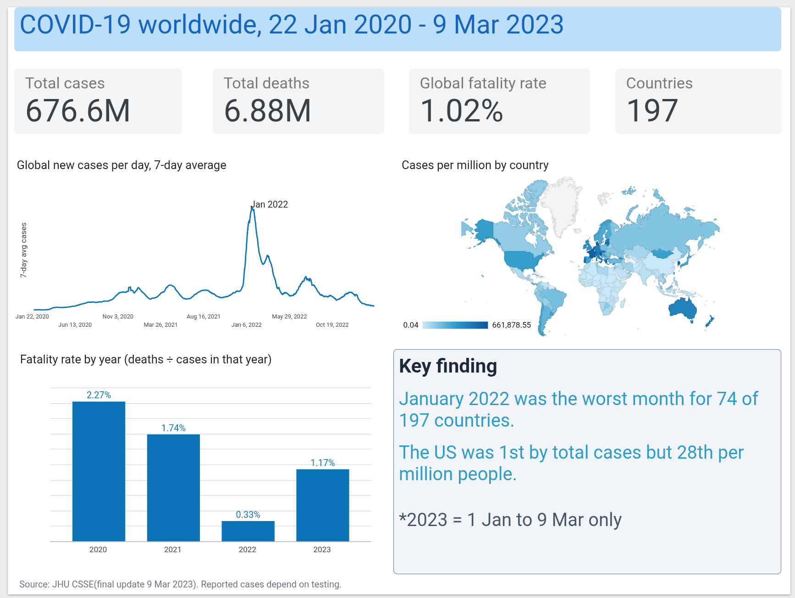
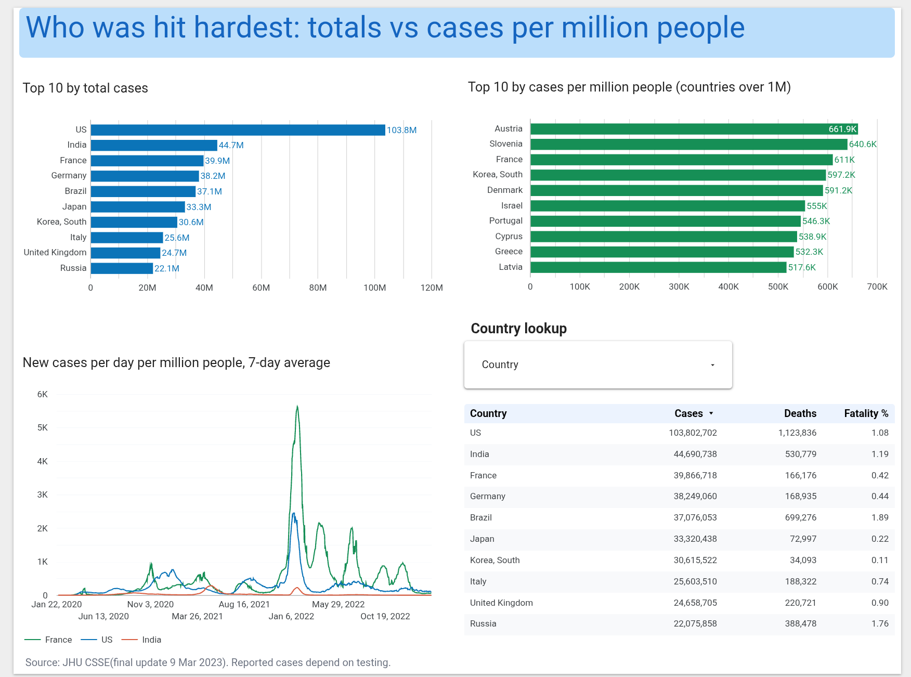

# COVID-19 Global Data Analysis

End-to-end analysis of reported COVID-19 cases and deaths in 197 countries (22 Jan 2020 – 9 Mar 2023): a Python data pipeline, SQL analysis in DuckDB, and an interactive Looker Studio dashboard.

**[Open the live dashboard](https://datastudio.google.com/reporting/55d33dd0-ae73-47d7-9ee3-1f4ecbe86015)** · [](https://colab.research.google.com/drive/1Gpd0_K_zsVm_bfJyp-Vm_nLamVWbUD4k?usp=sharing)




## Key findings
- The world total is 676.6 million reported cases and 6.88 million deaths (fatality rate 1.02%).
- The US had 15.3% of all cases. The top 3 countries by total cases (US, India, France) had 27.8% together.
- Rankings change a lot per million people (countries with 1M+ people). The US is 1st by total cases but 28th per million, and India is 2nd but 94th. Austria, Slovenia and France are highest per million.
- January 2022 (Omicron) was the worst month for 74 of 197 countries. January to March 2022 covers about 60% of countries.
- The fatality rate (deaths ÷ cases in the year) fell from 2.27% in 2020 to 1.74% in 2021 and 0.33% in 2022.

## How it was built
1. **Python (pandas):** download the JHU time series, add provinces up to country level, remove 4 non-country entries (2 cruise ships, 2 Olympic Games), add population from JHU's lookup table, then calculate new cases and deaths, 7-day averages, fatality rate and per-million figures.
2. **Checks:** world totals match JHU's final figures. The 7-day average calculated in SQL differs from the Python one by at most 0.004.
3. **SQL (DuckDB):** 7 queries using CTEs, window functions, RANK and ROW_NUMBER (`sql/covid_queries.sql`).
4. **Dashboard (Looker Studio):** 2 pages. Totals come from a one-row-per-country table, and charts over time come from the daily table.

## Repository
```
├── README.md
├── covid_analysis.ipynb      Python pipeline and SQL run
├── requirements.txt
├── sql/covid_queries.sql     7 queries
├── data/raw/                 original JHU files
├── data/processed/           daily and summary tables
└── images/                   dashboard screenshots
```

## How to run
Click the Colab badge, then choose Runtime → Run all. The notebook downloads the JHU files, builds the two tables in `data/processed/`, and runs the SQL file with DuckDB. The JHU repository is archived, so the data will not change.

## Limits
- These are reported cases. They depend on how much each country tested, so countries are not directly comparable.
- The fatality rate here is deaths ÷ cases in the same period, not the true infection fatality rate. Testing was low in early 2020, which inflates 2020.
- 2023 covers only 1 Jan to 9 Mar. JHU stopped updating on 9 Mar 2023.
- Daily new cases are set to 0 when JHU corrected a total downward, so yearly sums are about 0.1% above the final total.
- Antarctica has no population, so it has no per-million values.

## Contact
- LinkedIn: [linkedin.com/in/sagar-parmar2025](https://www.linkedin.com/in/sagar-parmar2025)
- Portfolio: [sagarparmar.pages.dev](https://sagarparmar.pages.dev/)
